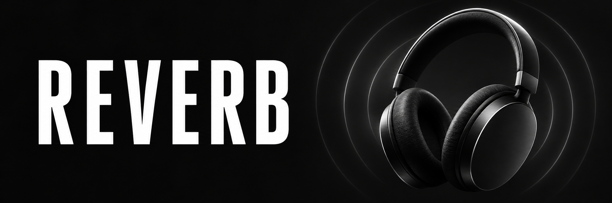

**Reverb is an Android music player for searching songs and artists, streaming tracks, and saving your favorites.**

[Releases](https://github.com/1clxrnce/Reverb/releases) · [Build from source](#build-from-source) · [How Reverb works](HOW_IT_WORKS.md)

## Listen with Reverb


- **Find music.** Search songs and artists together or narrow the results with the Songs and Artists filters. Browse trending tracks and visit artist pages.
- **Control playback.** Use the mini-player or open Now Playing for artwork, seek and volume controls, the queue, shuffle, repeat, and a sleep timer.
- **Save your library.** Favorite songs, create playlists, and revisit recently played tracks. Sign in to keep your library with your account.

## Install on Android

Reverb requires **Android 7.0 or later**. If an APK is attached to a GitHub release, download it from [Releases](https://github.com/1clxrnce/Reverb/releases) and open it on your phone. You can also build a debug APK from source.

## Build from source

Use **Flutter 3.44 or later** and **Android SDK Platform 37**. For a phone-only setup, connect this repository to an Android cloud build service and download the resulting APK through your browser.

```sh
flutter pub get
flutter build apk --debug
```

The APK is written to `build/app/outputs/flutter-apk/app-debug.apk`.

## Under the hood

Reverb uses **Flutter** for the Android interface, **mpv** for playback, and **Firebase** for accounts and the library. Music search and streaming use YouTube Music as the upstream source. [Read the technical walkthrough](HOW_IT_WORKS.md).
